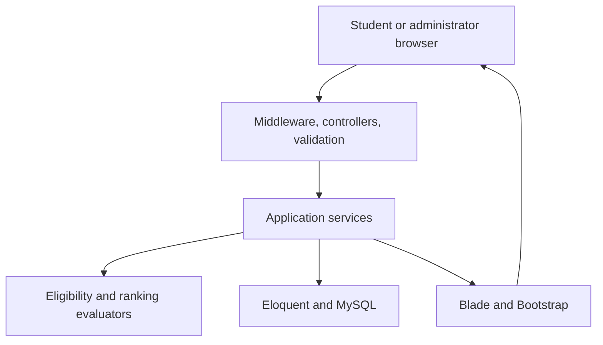

# ScholarMatch — System Architecture

- **Version:** 1.0
- **Status:** Implementation blueprint
- **Date:** 12 October 2026
- **Requirements:** [Product Requirements Document](PRD.md)

## 1. Architectural approach

ScholarMatch uses a Laravel monolith with server-rendered Blade pages, Bootstrap styling, and MySQL persistence. One application serves student and administrator experiences. This keeps local setup, authorization, deployment, and maintenance manageable for coursework while preserving clear boundaries between presentation, business decisions, and storage.

The browser submits normal HTTP requests. Laravel authenticates the session, authorizes access, validates input, invokes application services, and renders responses. JavaScript supports conditional forms and small interactions. Scholarship applications continue on official provider websites.



## 2. Application modules

| Module | Responsibility |
| --- | --- |
| Identity | Registration, sessions, roles, account activation |
| Profiles | Personal information, funding programme, academic records |
| Scholarships | Administrator editing, requirements, sources, lifecycle |
| Recommendations | Evaluation, filtering, ranking, pagination, explanations |
| Bookmarks | Owned, reversible scholarship saves |
| Reference data | Study fields and versioned income thresholds |
| Dashboards | Summaries derived from shared evaluation results |

Controllers coordinate requests without duplicating eligibility logic. Form Requests validate fields and conditional requirements. Policies enforce ownership and administrator permissions. Eloquent models represent persistence and relationships. Blade components render cards, badges, academic forms, and requirement explanations consistently. Present validation failures beside their corresponding controls.

Recommended directories are `app/Http/Controllers`, `app/Http/Requests`, `app/Policies`, `app/Models`, `app/Services`, `app/Enums`, `app/Data`, and `resources/views`. Student and administrator controller namespaces keep route responsibilities visible.

## 3. Domain services and contracts

`ScholarshipEligibilityService` evaluates normalized profile information against one scholarship. Criterion evaluators return Met, Not Met, Manual Verification Required, or Not Applicable, with student values, requirements, and explanations. An `EvaluationResult` data object contains the overall status, criterion results, academic route outcomes, selected ranking route, and nullable academic margin.

`IncomeCategoryResolver` applies the relevant maintained threshold configuration. `AcademicMarginCalculator` processes satisfied, comparable academic routes. `RecommendationService` loads the required records, coordinates evaluations, applies filters and ordering, and paginates the completed result set.

Evaluators receive loaded data and avoid hidden database queries. Their deterministic outputs are reused by recommendations, details, saved scholarships, and dashboards. Eligibility results are computed from current inputs initially, avoiding persisted decisions that become stale after edits.

## 4. Relational data model

Core tables follow the PRD: `users`, `student_profiles`, `student_academic_records`, `scholarships`, `scholarship_requirements`, `scholarship_academic_routes`, `study_fields`, `scholarship_study_fields`, `income_categories`, `scholarship_income_categories`, and `saved_scholarships`.

One user owns one profile; each profile owns multiple academic records. Scholarships own one requirements configuration and multiple alternative academic routes. Field and income-category restrictions use pivot relationships. Simple accepted enum sets, including enrolment statuses and institution types, use validated structured values with explicit restriction modes.

Store income and academic values using suitable decimal or integer columns. Preserve qualification type, result type, grading scale, completion status, and academic-record completeness. Current education remains separate from funding study level. Enforce foreign keys, unique profile ownership, unique bookmarks, and indexes supporting status, deadlines, and relationships.

Laravel infrastructure tables support database-backed sessions and cache where configured. Multi-record administrator and profile updates use transactions. Deactivation preserves historical references.

When administrators select No Restriction, persisted modes remain explicit even when accepted-value lists are empty. Publish validation rejects incomplete configurations. Income reference changes must affect subsequent evaluations, and numeric scholarship limits bypass category labels. Scholarship deactivation removes recommendation visibility without deleting existing bookmarks.

## 5. Eligibility and ranking pipeline

Load open, active scholarships with requirements, academic routes, and reference relationships through eager loading. Load the authenticated student’s profile and academic records once. Resolve applicable income rules, evaluate academic alternatives, then evaluate other compulsory criteria.

All conditions within an academic route must pass; any satisfied route passes the academic criterion. Incomplete information produces an unresolved result when no route passes. Complete information confirming every route fails produces failure. An explicit unrestricted criterion produces N/A; missing student information never does.

Any definite compulsory failure yields Not Eligible. Otherwise, unresolved criteria yield Manual Verification Required. Remaining evaluations are Eligible. Only Eligible scholarships receive calculated margins from fully satisfied routes with positive minima and compatible scales.

```text
margin = ((student result / required minimum) - 1) × 100
```

Select the highest valid route margin, retain its explanation, and round only for display. Default order is scored Eligible descending, unscored Eligible by deadline, Manual Verification by deadline, then Not Eligible by deadline. Equal margins use deadline and record identifier. Apply ordering before pagination.

## 6. Security and operational behaviour

Registration assigns student roles server-side. Authentication, active-account checks, policies, CSRF protection, password hashing, and ownership restrictions protect requests. Escape output, validate external URLs, and keep credentials outside Git. Production disables debug output and uses HTTPS.

Store deadline instants consistently, applying Asia/Kuala_Lumpur for date-only deadlines and explicit provider times when supplied. Determine effective closure during requests; expiry does not depend on a background worker. Closed bookmarks remain accessible. Source verification is separate from student eligibility.

## 7. Environments and deployment

Local development requires compatible PHP, Composer, and MySQL. Environment configuration supplies application keys and database settings. Migrations and labelled seed data reproduce the demonstration environment. Commit dependency lockfiles and select versions compatible with Azure’s available PHP runtime.

Deploy to Azure App Service Linux, targeting Free F1 where available, with Azure Database for MySQL Flexible Server. Configure the web root to Laravel’s `public` directory, encrypted database connections, restricted database access, writable application storage, and the provider’s HTTPS address.

Verify student subscription benefits, remaining credit, expiry, quotas, and MySQL eligibility before provisioning. Retain spending protection. Continuous workers and additional infrastructure are unnecessary for the initial request-driven application. Keep database exports and deployment instructions for recovery.

Deployment uses a build-and-test step, environment configuration, reviewed migrations, and a smoke test of authentication and recommendations. Preserve the application key across releases so existing encrypted data and sessions remain usable. Logging records operational errors without exposing passwords, database credentials, household income, or academic results. Database exports precede destructive schema changes.

## 8. Verification strategy

Unit tests cover criterion precedence, alternative routes, grading compatibility, income boundaries, margin calculations, zero minima, and deterministic ordering. Feature tests cover authorization, profile updates, bookmarks, filtering, pagination, and deadline closure. Shared fixtures verify identical decisions locally and online. Measure warmed local recommendation performance against the PRD target before deployment.
